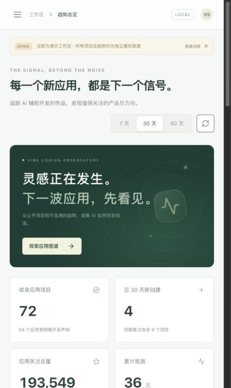

# VibeScope · AI 应用趋势观察站

一个面向数据开发求职的完整前后端项目：持续收录公开的 Vibe Coding 应用，比较应用类别、使用的开发工具、GitHub 星标变化和 Hacker News 讨论，并生成带证据的 AI 周报。

重点是可以实际运行的数据链路：**采集 → 原始数据 → 去重归一 → AI 分类 → 分层 SQL 指标 → API → 可视化 → 周报**。页面同时展示数据质量、采集任务和分类依据，方便在面试中沿着一条指标追溯到底层记录。



## 可以演示什么

- 趋势总览：7/30/90 天窗口、类别与开发工具分布、近期创建与首次收录项目。
- 应用发现：筛选、排序、CSV 导出；详情页展示星标历史、关联讨论、AI 分类与原文证据。
- 候选复核：区分应用作品、开发工具、教程资源；人工修正后不会被自动分类覆盖。
- AI 周报：先计算事实，再生成摘要；来源与统计区间随报告保存。
- 数据控制台：查看采集、分类、仓库和报告任务及运行结果；检查覆盖范围与数据新鲜度。

正式统计仅包含 `kind=application` 且 `evidence_level=explicit` 的项目。GitHub 与 HN 提供公开观察样本，界面不把它包装成全网应用数量或市场份额。统计定义见 [指标口径](docs/metrics.md)。

## 一键本地启动

需要 Docker Desktop，或 Docker Engine 与 Compose v2。首次启动需要拉取镜像和安装依赖。

```bash
./scripts/start.sh demo
```

浏览器打开 **[http://localhost:5180](http://localhost:5180)**。演示模式提供固定种子的合成数据及历史轨迹，适合展示交互与指标口径；它不代表真实项目排名或实际趋势。无需 GitHub 或 LLM key。

```bash
./scripts/check.sh demo   # 分类评估与 dbt 数据质量检查
./scripts/logs.sh demo    # 运行日志
./scripts/stop.sh demo    # 停止，保留数据库
```

数据库密码由启动脚本生成并保存在忽略提交的 `.runtime/demo.env` 中。数据库不暴露宿主机端口；前端与 API 只监听 `127.0.0.1`。这是单用户本地作品，未实现公网多用户认证。

## 切换真实采集

```bash
cp .env.example .env
# 编辑 .env，填写 GITHUB_TOKEN；需要模型分类/周报时再填写 LLM_*。
./scripts/stop.sh demo
./scripts/start.sh live
```

在数据控制台触发同步，再观察任务、候选分类及收录结果。`demo` 和 `live` 使用不同的 Compose project、PostgreSQL volume 与运行目录。两种模式默认使用相同端口，切换前停止另一种模式即可。不要删除 `.runtime` 后继续使用旧数据库卷：该目录保存该卷的本地连接密码。

| 配置 | 用途 |
| --- | --- |
| `GITHUB_TOKEN` | 提高公开 API 的请求额度；只在后端使用 |
| `LLM_BASE_URL` | 兼容 Chat Completions 的服务地址，填写服务提供方的 API base URL |
| `LLM_API_KEY`、`LLM_MODEL` | 模型调用凭据和模型名；留空时使用规则分类与事实模板摘要 |
| `TRACKING_LIMIT` | 最多追踪的仓库数，默认 1000 |
| `DAILY_CLASSIFICATION_LIMIT` | 每日自动分类额度（规则与模型合计），默认 100 |
| `WEB_PORT`、`API_PORT` | 宿主机本地端口，默认 5180、8000 |

真实采集启动当天只有当前观测。完整七天净增要等到精确的两端快照都存在；历史不足显示为未知，不补造数据。

## 技术结构

| 层 | 实现 |
| --- | --- |
| 前端 | React、TypeScript、Vite；生产环境 Nginx 代理 API |
| 服务 | Python、FastAPI、SQLAlchemy、Alembic |
| 调度 | 独立 Python worker、持久化任务记录 |
| 数据 | PostgreSQL；raw、DWD、DWS、ADS 分层；dbt 模型与测试 |
| AI | 结构化分类、原文证据、人工复核、事实约束周报 |
| 交付 | Docker Compose、独立演示模式、单元/集成测试、中文面试材料 |

仓库包含 `frontend/`、`backend/`、`warehouse/`、`data/` 和 `docs/`。API 契约见 [API contract](docs/api-contract.md)，数据库与模型关系见 [架构](docs/architecture.md) 和 [数据字典](docs/data-dictionary.md)。

## 开发与验证

```bash
cd backend
uv sync
uv run python -m app.cli init
uv run python -m app.cli seed
uv run uvicorn app.main:app --reload --port 8000
```

另一个终端在 `backend/` 运行 `uv run python -m app.worker`，第三个终端在 `frontend/` 运行 `npm ci` 和 `npm run dev`。本地快速开发默认 SQLite 演示库，不运行 dbt；PostgreSQL 数仓路径通过 Compose 验证。

```bash
cd backend
uv run pytest
uv run python -m app.cli evaluate
# 另在 frontend/ 执行 npm test 和 npm run build
# 完整 PostgreSQL 环境启动后，在项目根目录执行 ./scripts/check.sh demo
```

已执行 61 项后端测试、8 项前端测试和 30 项 PostgreSQL/dbt 数据测试，并通过 Docker 全栈 HTTP 验收。分类评估包含 40 条合成规格案例，以及 32 个真实 GitHub 来源的 AI 审读开发样本；后者的作品类型符合率为 84.38%，不是独立人工评估或模型泛化成绩。真实人类审核仍待维护者完成。验证状态与测量口径见 [验证记录](docs/validation.md)。演示数据规模、测试结果与模型评估成绩应以实际输出为准，简历不使用未经测量的吞吐量或准确率。

独立端到端接口验收：`python3 scripts/verify_http.py --base-url http://127.0.0.1:5180`。CI 工作流同时检查前端、后端和 PostgreSQL/dbt。

## 作品讲解材料

- [五分钟演示脚本](docs/demo.md)
- [面试讲解与简历素材](docs/interview.md)
- [指标口径与数据限制](docs/metrics.md)
- [架构与工程取舍](docs/architecture.md)

主要数据接口依据：[GitHub Search API](https://docs.github.com/en/rest/search/search)、[GitHub REST API 限流](https://docs.github.com/en/rest/using-the-rest-api/rate-limits-for-the-rest-api)、[Hacker News 官方 API](https://github.com/HackerNews/API)。
