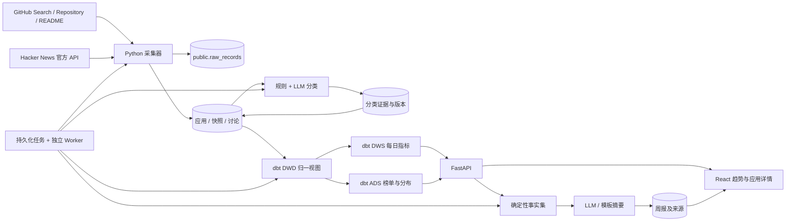

# 架构与数据流

## 分层职责

| 层 | 存储 | 目的 |
| --- | --- | --- |
| ODS | `public.raw_records` | 保留成功取得的原始响应及采集时间，支持追溯与重新解释 |
| 业务实体 | `public.applications`、`snapshots`、`discussions` | 用来源主键去重、保存当前状态与每日观测 |
| DWD | `dwd.dwd_applications`、`dwd_snapshots`、`dwd_discussions` | 统一字段、缺失分类、关联键和统计资格 |
| DWS | `dws.dws_daily_metrics` | 汇总观测样本及完整性，避免把缺采集当零增长 |
| ADS | `ads.ads_app_metrics`、`ads_category_metrics`、`ads_tool_metrics` | 提供页面使用的固定口径指标 |

当前 dbt 模型使用 PostgreSQL 视图。应用数量被 `TRACKING_LIMIT` 限定时，视图便于分类修正后及时重算；这是一个有意的本地规模取舍，不声称实现了分布式实时数仓。后续如果真实测量显示查询变慢，再针对 ADS 使用物化表或增量模型。

## 任务与服务

初始化服务先迁移数据库，仅在 demo 模式注入种子，然后执行 dbt build。初始化成功后才启动 API 和 worker，避免多个服务同时迁移或重复造数。API 接收任务请求并返回任务 ID；worker 执行采集、分类和报告。用户在控制台查看进度与结果，失败任务可以重新触发。

所有长期状态保存在 PostgreSQL。网络重试、查询覆盖与模型调用结果应通过任务和 coverage 记录可见，单次 API 返回成功不等于全量采集完成。逐条来源记录、仓库 ID 与按日快照键使重复执行不会重复计数。

## 证据与人工复核

分类的两条轴分别是作品类型和 AI 开发证据。应用含有 AI 功能，不自动意味着应用由 AI 编程工具开发；README 只是提到工具名，也不足以认定作者使用它制作了该应用。

分类同时存储工具标签、证据原文/URL、模型与提示版本、内容标识和分类时间。人工修正成为当前状态，并保留 `manual_override`；后续同步不能自动覆盖它。README 内容更新可以触发重新分类，历史分类记录继续保留。

## 运行边界

Compose 为 demo/live 各建一套 volume；同一个前端 API 合约用于两种模式。SQLite 仅支持轻量本地开发与测试，不替代 PostgreSQL/dbt 验证。项目默认单用户、仅本机访问，未包含用户账号、计费、消息通知或公网部署。
